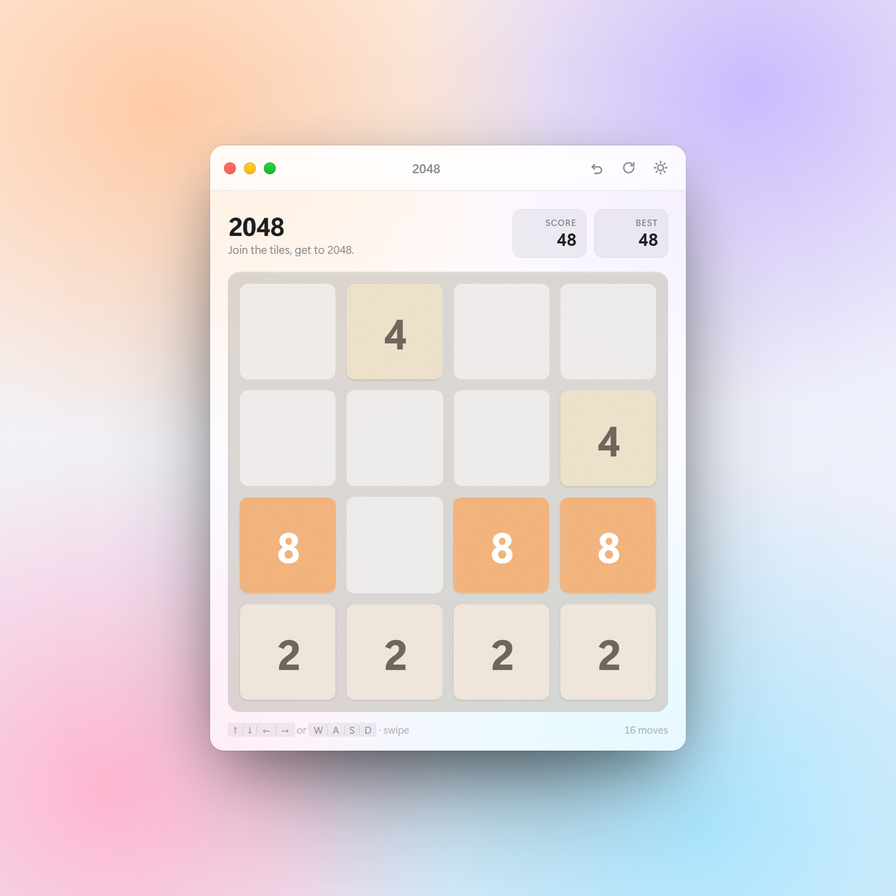

# game2048

macOS 스타일로 다시 만든 2048. 광고 없고, 추적 없고, 계정도 없습니다.
브라우저에서 바로 도는 정적 페이지 하나입니다. **혼자(Solo)**, **같은 기기에서 둘이(Duo)**, **친구와 온라인 대결(Online)**.

**▶ https://www.joongyu.co.kr/game2048/** (또는 https://joongyu01.github.io/game2048/)



---

## 무엇인가

[play2048.co](https://play2048.co)의 실제 배포 번들을 뜯어서 게임 규칙을 그대로 옮기고,
화면만 macOS 느낌(반투명 창, 신호등 버튼, 시스템 폰트, 다크 모드)으로 새로 그린 것입니다.
원본 사이트의 코드는 한 줄도 가져다 쓰지 않았습니다 — 관찰한 **규칙**만 다시 구현했습니다.

원본에 붙어 있던 것들은 전부 걷어냈습니다:

| 원본 | 여기 |
| --- | --- |
| 광고 스크립트 (PubNation) | 없음 |
| Google Analytics + 동의 배너 | 없음 |
| Sentry 오류 수집 | 없음 |
| 2048 Plus 구독 유도, 파워업 과금 | 없음 |
| 앱스토어 유도, 쿠키 동의 | 없음 |

Solo와 Duo는 바깥으로 요청하는 것이 **0건**입니다. 폰트도 아이콘도 전부 로컬/인라인입니다.
Online을 열 때만 MQTT 클라이언트를 그때 불러옵니다.

## 플레이

| 조작 | 키 |
| --- | --- |
| 이동 | `←` `→` `↑` `↓` 또는 `W` `A` `S` `D` |
| 이동 (Vim) | `H` `J` `K` `L` |
| 되돌리기 | `⌘Z` / `Ctrl+Z` |
| 새 게임 | `⌘R` / `Ctrl+R` |
| 터치 | 보드 위에서 스와이프 |
| 트랙패드 | 두 손가락 스와이프 |

진행 상황과 최고 점수는 `localStorage`에 저장돼서 창을 닫아도 이어집니다.
`⌘R`은 확인 없이 바로 새 게임을 시작합니다.

## 둘이서 (Duo)

툴바의 **Solo / Duo**로 바꿉니다. 모드를 바꾸면 새 보드로 시작합니다.

- 두 사람이 **같은 보드**를 번갈아 둡니다. 한 번 두면 턴이 넘어갑니다.
- 그 수에서 합쳐진 점수는 **둔 사람 몫**입니다. 점수판 P1/P2 중
  지금 차례인 쪽에 파란 테두리가 켜집니다.
- 아무것도 움직이지 않는 방향키는 턴을 넘기지 않습니다. 다시 두면 됩니다.
- 보드가 막히면 점수가 높은 쪽이 이깁니다. 동점이면 무승부.
- 되돌리기는 마지막 한 수를 되돌리고 **턴과 두 사람 점수까지** 함께 복구합니다.
- 2048을 만든 사람이 누구인지도 승리 화면에 표시됩니다.

서버가 없으므로 같은 기기에서 번갈아 하는 방식입니다. 떨어진 사람과 하려면
아래 Online을 쓰세요.

## 온라인 (Online)

툴바에서 **Online**을 고르면 방을 만들거나 코드로 들어갑니다. 최대 4명.

- 각자 **자기 보드**에서 동시에 플레이합니다. 순서를 기다리지 않습니다.
- 보드 위 띠에 참가자마다 **미니 보드 + 점수**가 실시간으로 뜹니다.
  누가 앞서는지 한눈에 보입니다.
- **먼저 2048을 만든 사람이 우승**입니다. 다들 막히면 점수가 높은 쪽이 이깁니다.
- 방 코드는 4자리(헷갈리는 O/0/I/1 제외). 코드를 누르면 복사됩니다.

연결은 **공개 MQTT 브로커**(broker.emqx.io, 안 되면 broker.hivemq.com)를 지나갑니다.
양쪽 모두 바깥으로 연결만 하므로 NAT·방화벽에 막히지 않습니다. 우리 서버는 없고,
방 상태는 브로커에 잠깐 보관될 뿐입니다.

- 호스트가 창을 닫으면 방이 닫힙니다.
- 공개 브로커라 같은 코드를 쓰는 사람이 있으면 섞일 수 있습니다(4자리 랜덤).

> 처음엔 WebRTC(PeerJS)로 만들었는데, 공개 TURN 릴레이가 사라져서 통신사 NAT
> 뒤에 있는 두 사람은 아예 연결되지 않았습니다. 그래서 MQTT로 바꿨습니다.

## 훈수와 장난

옆에서 참견하는 캐릭터가 있습니다. 기본 켜짐이고 툴바의 말풍선 버튼으로 끕니다.

- 점수를 크게 냈는지, 판이 막혔는지, 오래 고민하는지에 따라 다른 말을 합니다.
- 4.5초에 한 번, 그리고 항상은 아니게 말합니다. 계속 떠들지 않습니다.

말풍선 옆 반짝이 버튼은 **장난**입니다. 게임 상태는 절대 건드리지 않고 화면만
잠깐 흔듭니다 — 보드가 기울거나, 좌우가 뒤집히거나, 흐려지거나, 타일이 돌아갑니다.
가끔 "축하합니다! 4096 달성!"이라고 속였다가 "…농담이야."라고 합니다.

## 규칙 (원본에서 확인한 그대로)

- 보드는 4×4. 시작할 때 빈 칸 두 곳에 타일이 놓입니다.
- 새 타일은 빈 칸 중 **균등 확률**로 한 곳, 값은 **2가 90%, 4가 10%**.
- 한 번의 이동은 방향별로 **한 번만** 훑습니다. 타일은 목적지 쪽에서 안쪽으로
  처리되기 때문에, 이미 합쳐진 타일은 같은 이동에서 두 번 합쳐지지 않습니다.
  - `2 2 2 2` → `4 4` (점수 8). `8`이 되지 않습니다.
  - `4 2 2` → `4 4`. `2 2`만 합쳐집니다.
- 합쳐진 타일의 값이 점수로 더해집니다.
- 보드가 꽉 차고 상하좌우 어디로도 합칠 수 없으면 게임 오버.
- 2048을 만들면 축하 화면이 뜨고, 계속 플레이할 수 있습니다.

원본과 다른 점 하나: 원본은 보드가 막혔을 때만 승리를 판정합니다(2048을 만들어도
바로 축하하지 않음). 여기서는 2048이 만들어지는 순간 축하 화면을 띄웁니다. 그 편이 자연스러워서요.

## 구조

```
index.html      마크업만
styles.css      테마 토큰 + 레이아웃 + 애니메이션
game.js         규칙 엔진 (DOM/타이머/저장소 없음, 순수 함수)
app.js          렌더링, 입력, 저장, 다이얼로그, 훈수, 온라인 방
tests/          규칙 테스트 (의존성 없음)
```

`game.js`는 UMD라서 브라우저에서는 `window.Game2048`, Node에서는 `require()`로 씁니다.
그래서 같은 코드를 테스트와 화면이 함께 씁니다.

`applyMove()`는 새 보드와 함께 **애니메이션 계획**을 돌려줍니다.
`moves`(미끄러진 타일)와 `merges`(충돌한 두 조각과 그 결과)를 그대로 DOM에 흘려보내면
화면이 맞춰집니다.

## 테스트

```bash
node --test
```

15개 테스트, 의존성 없음. 합치기 순서, 한 번만 합치기, 세로 이동, 게임 오버 판정,
저장/복원 왕복, 그리고 무작위 보드 4,000판에 대한 불변식(값 보존, 타일 ID 유일성,
좌표 정합성)을 확인합니다.

`tests/ui.check.js`는 브라우저에서 Solo/Duo 전환, 턴 넘김, 점수 귀속, 되돌리기,
새로고침 후 복원까지 확인하는 선택 스크립트입니다. Playwright가 필요합니다.

`tests/net.check.js`는 브라우저 두 개를 띄워 방 만들기 → 코드로 참가 → 대기 인원 표시 →
레이스 시작 → 서로의 미니 보드가 갱신되는지까지 확인합니다.

```bash
npm i --no-save playwright && node tests/ui.check.js && node tests/net.check.js
```

## 로컬에서 열기

`index.html`을 더블클릭하면 됩니다. 빌드 없음, 설치 없음.

## 크레딧

- 원작: [Gabriele Cirulli의 2048](https://github.com/gabrielecirulli/2048) (MIT)
- 이 저장소의 코드: 규칙을 관찰해 독립적으로 다시 구현한 것

## 라이선스

MIT — [LICENSE](LICENSE) 참고.
